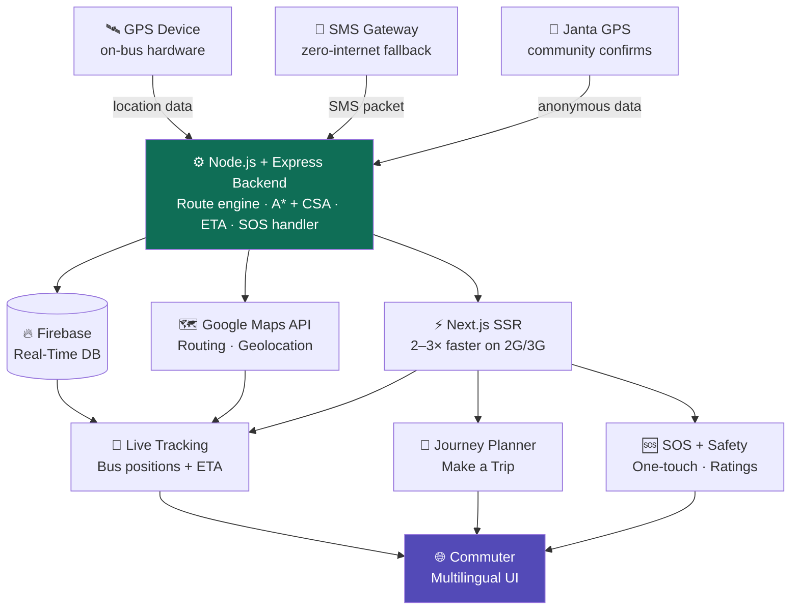

# 🚌 BusEasy — Real-Time Bus Tracking & Passenger Safety Platform

> **Smart India Hackathon 2025** · Team Lorem Ipsum · Theme: Open Innovation

BusEasy is an ultra-low-cost, GPS+SMS-powered transit platform that brings live bus tracking, intelligent journey planning, and integrated passenger safety to Indian cities — with full regional language support and no dependency on mobile internet.

---

## 🚨 Problem Statement

Indian public transit suffers from four core failures:

- **Wasted time & money** — unpredictable buses reduce commuter productivity
- **Safety risks** — no live tracking or multilingual support excludes and endangers commuters
- **Inefficient infrastructure** — lack of real-time data prevents network optimization
- **First & last-mile gap** — difficulty reaching bus stops from final destinations discourages transit use

---

## ✨ Features

### 🗺️ Live Tracking
Real-time bus positions using a GPS+SMS model — no mobile internet required on the vehicle.

### 🧭 Journey Planner (Make a Trip)
Intelligent trip planning with accurate ETAs powered by the A* and Connection Scan algorithms.

### 🌐 Regional Language Support
Full multilingual UI built for Bharat — non-English speakers can use every feature.

### 🆘 SOS & Safety Ratings
One-touch emergency SOS and community-sourced route safety ratings integrated into the core app.

### 👥 Janta-Powered GPS
A "Confirm My Bus" button lets users contribute anonymous location data, creating a self-healing, resilient network.

### ⚡ Works on 2G/3G
Server-Side Rendering (SSR) via Next.js delivers 2–3x faster load times on slow networks.

---

## 💡 Key Innovations

| Metric | Value |
|--------|-------|
| Cost vs. standard data plans | **>90% cheaper** |
| Recurring cost per bus/month | **< ₹30** |
| One-time hardware cost per bus | **< ₹1000** |
| Network uptime | **>99.5%** |
| Coverage across India | **>99%** |
| Scalability | **1000+ vehicles** |

---

## 🛠️ Tech Stack

| Layer | Technology |
|-------|-----------|
| Frontend | Next.js (SSR), TypeScript |
| Styling | Tailwind CSS |
| Backend | Node.js + Express |
| Database | Firebase (Real-Time Database) |
| Maps | Google Maps Platform |
| Templating | EJS |
| Hosting | Scalable web hosting |

---

## 🏗️ Architecture



---

## 📁 Project Structure

```
SIH-2025/
├── Frontend/        # Next.js app (SSR, Tailwind CSS)
├── Backend/         # Node.js + Express API
├── views/           # EJS templates
├── package.json
└── .gitignore
```

---

## 🚀 Getting Started

### Prerequisites
- Node.js v18+
- npm or yarn
- Firebase project credentials
- Google Maps API key

### Installation

```bash
git clone https://github.com/Charul192/SIH-2025.git
cd SIH-2025
npm install
```

### Backend

```bash
cd Backend
npm install
# Add your Firebase credentials and Google Maps API key to .env
npm start
```

### Frontend

```bash
cd Frontend
npm install
npm run dev
```

---

## 🌍 Impact

**Economic** — Time savings, lower fleet operational costs, reduced urban congestion losses.

**Environmental** — Gamified incentives for green commuting, significant reduction in city carbon footprint.

**Social** — City-wide emergency response network, community-powered safety, full inclusivity through regional languages.

---

## 📄 License

This project was built for Smart India Hackathon 2025. All rights reserved by the team.
